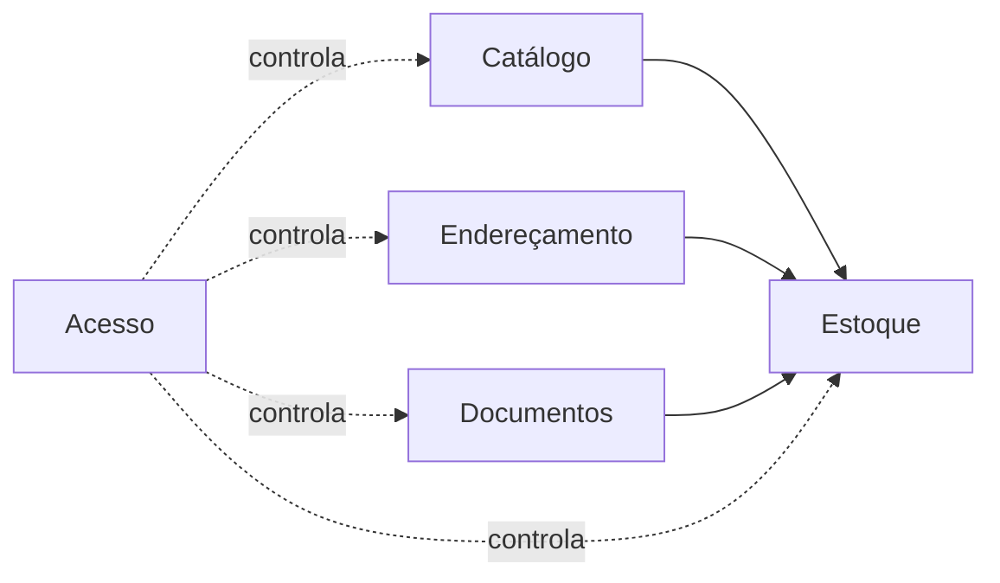

# Modelo de domínio

Este documento descreve as regras do negócio, independentemente de tela ou tecnologia. A tradução para tabelas está em [[banco-de-dados]].

## Os contextos do sistema

O sistema se divide em cinco assuntos. Cada um tem suas próprias regras e pode ser entendido separadamente.

| Contexto | Responde | Entidades |
|---|---|---|
| **Catálogo** | O que a empresa guarda? | Categoria, Família, Variante |
| **Endereçamento** | Onde as coisas podem ficar? | Local |
| **Estoque** | Quanto há, onde, e como chegou lá? | Movimentação, Saldo, Inventário |
| **Documentos** | O que foi pedido para sair? | Documento de saída, Item do documento |
| **Acesso** | Quem pode fazer o quê? | Perfil |

O contexto de **Estoque** é o centro: ele usa o Catálogo e o Endereçamento, e é acionado pelos Documentos.

## Catálogo

**Estrutura**: uma [[glossario#Categoria|categoria]] tem várias [[glossario#Família|famílias]]; uma família tem várias [[glossario#Variante|variantes]].

Regras:
1. O código da variante é único em todo o sistema.
2. Os atributos de uma variante seguem a lista definida na categoria da sua família.
3. Uma variante com histórico nunca é apagada, só desativada.
4. O estoque mínimo de uma variante é o valor próprio dela, se houver; senão, o da categoria.

## Endereçamento

**Estrutura**: um [[glossario#Local|local]] pode estar dentro de outro, formando uma árvore de qualquer profundidade.

Regras:
1. O código do local é único.
2. Um local não pode ficar dentro de si mesmo nem de um descendente seu.
3. Qualquer nível da árvore pode guardar mercadoria. Assim dá para registrar "está no Galpão 2" antes de o galpão ter setores definidos, e detalhar depois por transferência.
4. Um local com saldo não pode ser desativado.

## Estoque

Este é o agregado principal. **A movimentação é o fato; o saldo é a consequência.**

Regras:
1. Toda alteração de quantidade acontece por uma [[glossario#Movimentação|movimentação]]. Não existe outra forma.
2. A quantidade de uma movimentação é sempre maior que zero. O tipo e os locais dizem o sentido.
3. Cada tipo exige origem e destino conforme a tabela do [[glossario#Movimentação|glossário]].
4. Uma saída ou transferência não pode ser maior que o [[glossario#Saldo|saldo]] da origem. O saldo nunca fica negativo.
5. Movimentação e saldo são gravados juntos. Se um falhar, o outro é desfeito.
6. Uma movimentação não é alterada nem apagada. Erro se corrige com outra movimentação.
7. Toda movimentação registra o usuário que estava logado. Esse dado vem da sessão, nunca de um campo preenchido na tela.

### Inventário

1. Só existe um [[glossario#Inventário|inventário]] aberto por local.
2. Ao abrir, o sistema guarda o que dizia ter no local naquele momento.
3. Itens sem quantidade contada são ignorados na conclusão.
4. Ao concluir, cada diferença entre o contado e o saldo atual vira uma movimentação de ajuste ligada ao inventário.
5. Um inventário concluído ou cancelado não pode ser reaberto.

## Documentos

1. O [[glossario#Protocolo|protocolo]] é único.
2. Um [[glossario#Documento de saída|documento]] nasce "pendente".
3. Na [[glossario#Baixa|baixa]], quem confirma informa de qual local sai cada item. Um item pode sair de mais de um local.
4. O total retirado de cada variante deve ser exatamente o pedido no documento. Não existe baixa parcial.
5. A baixa gera uma movimentação de saída por retirada, todas ligadas ao documento.
6. Um documento baixado ou cancelado não pode ser baixado de novo.
7. Se faltar saldo para qualquer item, nada é baixado.

## Acesso

Perfis e permissões estão em [[security-model]].

## Onde cada regra é garantida

As regras deste documento são garantidas **pelo backend**, em funções que rodam no servidor, conferem o perfil de quem chama e gravam o saldo de forma condicional. Isso significa que elas valem mesmo que uma tela tenha um defeito, porque nenhuma tela fala com o banco. O banco reforça o básico: códigos únicos, quantidades válidas e saldo nunca negativo. Detalhes em [[backend]], em [[banco-de-dados]] e na decisão [[decisions#ADR-15 Regras no backend e banco simples|ADR-15]].
