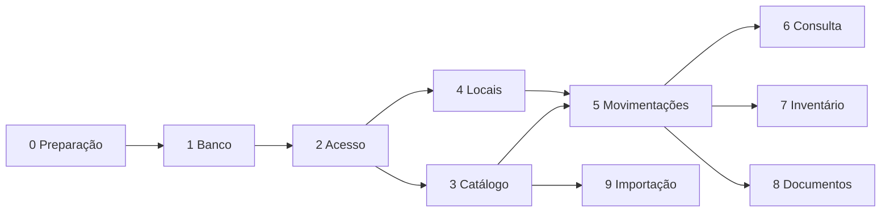

# Roteiro de construção

O sistema é construído em dez etapas. Cada etapa depende das anteriores e entrega algo que pode ser testado sozinho.

As etapas 3 e 4 podem andar ao mesmo tempo, assim como 6, 7, 8 e 9.

Cada etapa tem uma frente responsável (banco de dados, backend ou front-end). A divisão e a ordem das fases estão no [[decisions#ADR-13 Divisão do trabalho por frente|ADR-13]].

## Quadro

| Etapa | Entrega | Situação |
|---|---|---|
| [[etapa-0-preparacao\|Etapa 0 — Preparação]] | Deixar todo mundo com o projeto rodando no próprio computador, no mesmo repositório e no mesmo banco de desenvolvimento. | Em execução |
| [[etapa-1-banco\|Etapa 1 — Banco de dados]] | Criar toda a estrutura do banco a partir do arquivo de migração. | A fazer |
| [[etapa-2-acesso\|Etapa 2 — Acesso]] | Login, perfis e liberação de usuários. | A fazer |
| [[etapa-3-catalogo\|Etapa 3 — Catálogo]] | Cadastro de categorias, famílias e variantes. | A fazer |
| [[etapa-4-locais\|Etapa 4 — Locais]] | Cadastro da árvore de endereços. | A fazer |
| [[etapa-5-movimentacoes\|Etapa 5 — Movimentações]] | Registrar entrada, saída e transferência, e mostrar o histórico. | A fazer |
| [[etapa-6-consulta\|Etapa 6 — Consulta]] | Responder rápido, no celular, "onde está?" e "o que há aqui?". | A fazer |
| [[etapa-7-inventario\|Etapa 7 — Inventário]] | Contar um local e corrigir as diferenças com registro. | A fazer |
| [[etapa-8-documentos\|Etapa 8 — Documentos de saída]] | Receber pedidos de outro sistema e dar baixa por QR code. | A fazer |
| [[etapa-9-importacao\|Etapa 9 — Importação]] | Carregar o catálogo inicial a partir de planilha. | A fazer |

Situações possíveis: **A fazer**, **Em execução**, **Concluída**. Atualize esta tabela quando a etapa mudar.

## Como usar

1. Escolha uma tarefa da etapa em execução e coloque seu nome em "Responsável".
2. Trabalhe em uma branch própria, como explica [[contribuicao]].
3. Marque a caixa da tarefa quando o pull request for aceito.
4. A etapa só é concluída quando todos os itens de "Pronto quando" estiverem marcados.
