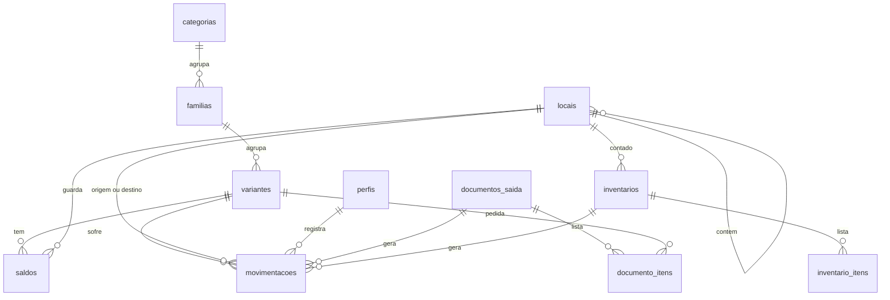

# Banco de dados

Este documento é a especificação do banco: diz o que cada parte precisa fazer e por quê. A partir dele, a frente de banco de dados escreve as migrações (o SQL) em `backend/supabase/migrations/` e monta o banco no Supabase. As regras de negócio por trás estão em [[domain-model]].

## Visão das tabelas



## Tabelas

| Tabela | Guarda | Observações |
|---|---|---|
| `perfis` | Nome, e-mail e cargo de cada usuário | Criado automaticamente quando alguém se cadastra, com cargo `pendente` |
| `categorias` | Tipos de produto | `atributos` lista as características da categoria; `limiar_padrao` é o estoque mínimo herdado |
| `familias` | Modelos de produto | Pertence a uma categoria |
| `variantes` | Itens contáveis | `codigo` único; `atributos` com os valores; `estoque_minimo` vazio significa "herda da categoria" |
| `locais` | Endereços físicos em árvore | `pai_id` aponta para o local que o contém; `codigo` único; `capacidade` é opcional |
| `movimentacoes` | Histórico | Só recebe linhas novas. Não aceita alteração nem exclusão |
| `saldos` | Quantidade por variante e local | Ninguém grava direto. Só as funções alteram |
| `inventarios` | Contagens de um local | Um aberto por local |
| `inventario_itens` | Itens de uma contagem | Quantidade do sistema e quantidade contada |
| `documentos_saida` | Pedidos vindos de outro sistema | `protocolo` único; status `pendente`, `baixado` ou `cancelado` |
| `documento_itens` | Itens de um documento | Variante e quantidade pedida |

## Como os atributos funcionam

A categoria diz **quais** atributos existem:

```json
[
  {"chave": "potencia_w", "rotulo": "Potência (W)", "tipo": "numero"},
  {"chave": "temperatura_cor_k", "rotulo": "Temperatura de cor (K)", "tipo": "numero"},
  {"chave": "tensao", "rotulo": "Tensão", "tipo": "texto"}
]
```

A variante guarda **os valores**:

```json
{"potencia_w": 100, "temperatura_cor_k": 5000, "tensao": "bivolt"}
```

Assim uma categoria nova, com características próprias, é criada pela tela, sem alterar a estrutura do banco.

## Funções: a única porta de escrita do estoque

O aplicativo não soma nem subtrai saldo. Ele chama uma função do banco, e a função faz tudo dentro de uma **transação**: ou todos os passos acontecem, ou nenhum.

| Função | O que faz | Quem pode chamar |
|---|---|---|
| `registrar_movimentacao` | Entrada, saída avulsa, transferência ou ajuste manual | Gerente de estoque, admin |
| `confirmar_saida_documento` | Baixa todos os itens de um documento, dos locais indicados | Gerente de estoque, admin |
| `abrir_inventario` | Cria a contagem de um local com a lista atual do sistema | Gerente de estoque, admin |
| `concluir_inventario` | Fecha a contagem e gera os ajustes | Gerente de estoque, admin |

### O que acontece em uma movimentação

1. A função confere se quem chamou tem permissão.
2. Se há origem, ela **trava** a linha de saldo daquele item naquele local. Outra operação no mesmo item espera a vez.
3. Confere se há saldo suficiente. Se não houver, interrompe com erro e nada é gravado.
4. Diminui o saldo da origem e aumenta o do destino.
5. Grava a linha no histórico, com o usuário da sessão.

Exemplo de chamada a partir do aplicativo:

```ts
await supabase.rpc("registrar_movimentacao", {
  p_variante_id: variante.id,
  p_tipo: "transferencia",
  p_quantidade: 8,
  p_origem_id: localOrigem.id,
  p_destino_id: localDestino.id,
  p_justificativa: "Reorganização do setor",
});
```

### Baixa de um documento

`confirmar_saida_documento` recebe o documento e a lista de retiradas:

```json
[
  {"variante_id": "…", "local_id": "…", "quantidade": 8},
  {"variante_id": "…", "local_id": "…", "quantidade": 2}
]
```

A função trava o documento, confere que ele está pendente, confere que o total retirado de cada variante é igual ao pedido, registra as saídas e marca o documento como baixado. Qualquer falha desfaz tudo.

## Visões de consulta

| Visão | Entrega |
|---|---|
| `locais_com_caminho` | Cada local com o caminho completo ("Galpão 1 > Setor A > Módulo 03") e o nível na árvore |
| `estoque_por_variante` | Saldo total de cada variante, o estoque mínimo que vale para ela e se está crítica |

## Proteções garantidas pelo banco

São o critério de aceite do banco: cada linha precisa ser testada no Supabase de desenvolvimento antes de o banco ser entregue.

| Situação | Resultado |
|---|---|
| Saída maior que o saldo | Erro "Saldo insuficiente", nada é gravado |
| Entrada com local de origem preenchido | Recusada pela restrição de tipo |
| Alterar ou apagar uma movimentação | Não tem efeito |
| Gravar direto em `saldos` | Recusado |
| Baixar o mesmo documento duas vezes | Erro na segunda tentativa |
| Retirada diferente do pedido no documento | Erro, nada é baixado |
| Colocar um local dentro de um descendente | Erro |
| Desativar um local com mercadoria | Erro |
| Apagar uma variante com histórico | Recusado |
| Perfil pendente ou visitante sem login lendo dados | Não enxerga nenhuma linha |
| Estoquista tentando movimentar ou cadastrar | Recusado |

## Como alterar o banco

1. Nunca edite uma migração que já foi aplicada.
2. Crie um arquivo novo em `backend/supabase/migrations/` com data e hora no nome.
3. Atualize este documento e o [[domain-model]] no mesmo pull request.

Passo a passo em [[ambiente]].
