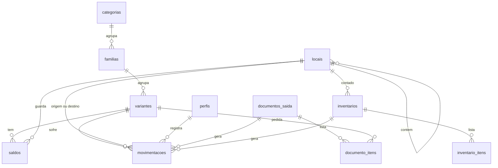

# Banco de dados

Este documento é a especificação do banco: diz o que cada parte precisa fazer e por quê. A partir dele, a frente de banco de dados escreve as migrações (o SQL) em `backend/supabase/migrations/` e monta o banco no Supabase. As regras de negócio por trás estão em [[domain-model]].

## Visão das tabelas



## Tabelas

| Tabela | Guarda | Observações |
|---|---|---|
| `perfis` | Nome, e-mail e cargo de cada usuário | Criado automaticamente quando alguém se cadastra, com cargo `pendente` |
| `categorias` | Tipos de produto | `atributos` lista as características da categoria; `limiar_padrao` é o estoque mínimo herdado |
| `familias` | Modelos de produto | Pertence a uma categoria |
| `variantes` | Itens contáveis | `codigo` único; `atributos` com os valores; `estoque_minimo` vazio significa "herda da categoria" |
| `locais` | Endereços físicos em árvore | `pai_id` aponta para o local que o contém; `codigo` único; `capacidade` é opcional |
| `movimentacoes` | Histórico | Só recebe linhas novas. Não aceita alteração nem exclusão |
| `saldos` | Quantidade por variante e local | Ninguém grava direto. Só as funções alteram |
| `inventarios` | Contagens de um local | Um aberto por local |
| `inventario_itens` | Itens de uma contagem | Quantidade do sistema e quantidade contada |
| `documentos_saida` | Pedidos vindos de outro sistema | `protocolo` único; status `pendente`, `baixado` ou `cancelado` |
| `documento_itens` | Itens de um documento | Variante e quantidade pedida |

## Como os atributos funcionam

A categoria diz **quais** atributos existem:

```json
[
  {"chave": "potencia_w", "rotulo": "Potência (W)", "tipo": "numero"},
  {"chave": "temperatura_cor_k", "rotulo": "Temperatura de cor (K)", "tipo": "numero"},
  {"chave": "tensao", "rotulo": "Tensão", "tipo": "texto"}
]
```

A variante guarda **os valores**:

```json
{"potencia_w": 100, "temperatura_cor_k": 5000, "tensao": "bivolt"}
```

Assim uma categoria nova, com características próprias, é criada pela tela, sem alterar a estrutura do banco.

## Funções: a única porta de escrita do estoque

O aplicativo não soma nem subtrai saldo. Ele chama uma função do banco, e a função faz tudo dentro de uma **transação**: ou todos os passos acontecem, ou nenhum.

| Função | O que faz | Quem pode chamar |
|---|---|---|
| `registrar_movimentacao` | Entrada, saída avulsa, transferência ou ajuste manual | Gerente de estoque, admin |
| `confirmar_saida_documento` | Baixa todos os itens de um documento, dos locais indicados | Gerente de estoque, admin |
| `abrir_inventario` | Cria a contagem de um local com a lista atual do sistema | Gerente de estoque, admin |
| `concluir_inventario` | Fecha a contagem e gera os ajustes | Gerente de estoque, admin |

### O que acontece em uma movimentação

1. A função confere se quem chamou tem permissão.
2. Se há origem, ela **trava** a linha de saldo daquele item naquele local. Outra operação no mesmo item espera a vez.
3. Confere se há saldo suficiente. Se não houver, interrompe com erro e nada é gravado.
4. Diminui o saldo da origem e aumenta o do destino.
5. Grava a linha no histórico, com o usuário da sessão.

Exemplo de chamada a partir do aplicativo:

```ts
await supabase.rpc("registrar_movimentacao", {
  p_variante_id: variante.id,
  p_tipo: "transferencia",
  p_quantidade: 8,
  p_origem_id: localOrigem.id,
  p_destino_id: localDestino.id,
  p_justificativa: "Reorganização do setor",
});
```

### Baixa de um documento

`confirmar_saida_documento` recebe o documento e a lista de retiradas:

```json
[
  {"variante_id": "…", "local_id": "…", "quantidade": 8},
  {"variante_id": "…", "local_id": "…", "quantidade": 2}
]
```

A função trava o documento, confere que ele está pendente, confere que o total retirado de cada variante é igual ao pedido, registra as saídas e marca o documento como baixado. Qualquer falha desfaz tudo.

## Visões de consulta

| Visão | Entrega |
|---|---|
| `locais_com_caminho` | Cada local com o caminho completo ("Galpão 1 > Setor A > Módulo 03") e o nível na árvore |
| `estoque_por_variante` | Saldo total de cada variante, o estoque mínimo que vale para ela e se está crítica |

## Contrato com o aplicativo

O aplicativo é escrito contando com os nomes e tipos desta seção. A frente de banco de dados decide **como** construir (o SQL, os índices, a forma das restrições), mas os nomes de tabelas, colunas, funções e parâmetros precisam ser exatamente estes. Se algum precisar mudar, combine com a frente de backend e atualize este documento antes.

Em todas as tabelas, `id` é gerado pelo banco e `criado_em` recebe a data e hora do momento da gravação.

### Tipos com valores fixos

| Tipo | Valores |
|---|---|
| `cargo` | `pendente`, `estoquista`, `gerente`, `gerente_estoque`, `admin` |
| `tipo_movimentacao` | `entrada`, `saida`, `transferencia`, `ajuste` |
| `status_inventario` | `aberto`, `concluido`, `cancelado` |
| `status_documento` | `pendente`, `baixado`, `cancelado` |

### Colunas de cada tabela

**`perfis`**

| Coluna | Tipo | Obrigatória | Observação |
|---|---|---|---|
| `id` | uuid | sim | O mesmo `id` do usuário no login do Supabase. Apagar o usuário apaga o perfil |
| `nome` | texto | sim | |
| `email` | texto | sim | |
| `cargo` | `cargo` | sim | Padrão `pendente` |
| `criado_em` | data e hora | sim | |

**`categorias`**

| Coluna | Tipo | Obrigatória | Observação |
|---|---|---|---|
| `id` | uuid | sim | |
| `nome` | texto | sim | Único |
| `limiar_padrao` | inteiro | sim | Padrão 0. Não pode ser negativo |
| `atributos` | JSON | sim | Lista de atributos (ver "Como os atributos funcionam"). Padrão: lista vazia |
| `criado_em` | data e hora | sim | |

**`familias`**

| Coluna | Tipo | Obrigatória | Observação |
|---|---|---|---|
| `id` | uuid | sim | |
| `categoria_id` | uuid | sim | Aponta para `categorias` |
| `nome` | texto | sim | Único |
| `descricao` | texto | não | |
| `imagem_url` | texto | não | |
| `ativo` | verdadeiro/falso | sim | Padrão verdadeiro |
| `criado_em` | data e hora | sim | |

**`variantes`**

| Coluna | Tipo | Obrigatória | Observação |
|---|---|---|---|
| `id` | uuid | sim | |
| `familia_id` | uuid | sim | Aponta para `familias` |
| `codigo` | texto | sim | Único em todo o sistema |
| `nome` | texto | sim | |
| `atributos` | JSON | sim | Valores dos atributos da categoria. Padrão: objeto vazio |
| `preco` | decimal (12,2) | não | Não pode ser negativo |
| `imagem_url` | texto | não | |
| `estoque_minimo` | inteiro | não | Vazio = herda `limiar_padrao` da categoria. Não pode ser negativo |
| `monitorar` | verdadeiro/falso | sim | Padrão verdadeiro. Falso = nunca aparece como crítica |
| `ativo` | verdadeiro/falso | sim | Padrão verdadeiro |
| `criado_em` | data e hora | sim | |
| `atualizado_em` | data e hora | sim | |

**`locais`**

| Coluna | Tipo | Obrigatória | Observação |
|---|---|---|---|
| `id` | uuid | sim | |
| `pai_id` | uuid | não | Aponta para o local que contém este. Vazio = local de primeiro nível |
| `nome` | texto | sim | |
| `tipo` | texto | sim | Texto livre: "Galpão", "Setor", "Módulo"... |
| `codigo` | texto | sim | Único |
| `capacidade` | inteiro | não | Se preenchida, maior que zero |
| `ativo` | verdadeiro/falso | sim | Padrão verdadeiro |
| `criado_em` | data e hora | sim | |

**`documentos_saida`**

| Coluna | Tipo | Obrigatória | Observação |
|---|---|---|---|
| `id` | uuid | sim | |
| `protocolo` | texto | sim | Único. É o que o QR code carrega |
| `origem` | texto | sim | Nome do sistema que emitiu o documento |
| `cliente_nome` | texto | não | |
| `solicitante_nome` | texto | não | |
| `status` | `status_documento` | sim | Padrão `pendente` |
| `criado_em` | data e hora | sim | |
| `baixado_por` | uuid | não | Aponta para `perfis`. Preenchido na baixa |
| `baixado_em` | data e hora | não | Preenchido na baixa |

**`documento_itens`**

| Coluna | Tipo | Obrigatória | Observação |
|---|---|---|---|
| `id` | uuid | sim | |
| `documento_id` | uuid | sim | Aponta para `documentos_saida`. Apagar o documento apaga os itens |
| `variante_id` | uuid | sim | Aponta para `variantes` |
| `quantidade` | inteiro | sim | Maior que zero |

Uma variante aparece no máximo uma vez em cada documento.

**`inventarios`**

| Coluna | Tipo | Obrigatória | Observação |
|---|---|---|---|
| `id` | uuid | sim | |
| `local_id` | uuid | sim | Aponta para `locais` |
| `status` | `status_inventario` | sim | Padrão `aberto` |
| `observacao` | texto | não | |
| `aberto_por` | uuid | sim | Aponta para `perfis` |
| `aberto_em` | data e hora | sim | |
| `concluido_por` | uuid | não | Aponta para `perfis` |
| `concluido_em` | data e hora | não | |

Só pode existir um inventário `aberto` por local.

**`inventario_itens`**

| Coluna | Tipo | Obrigatória | Observação |
|---|---|---|---|
| `inventario_id` | uuid | sim | Aponta para `inventarios`. Apagar o inventário apaga os itens |
| `variante_id` | uuid | sim | Aponta para `variantes` |
| `quantidade_sistema` | inteiro | sim | Saldo no momento da abertura. Não pode ser negativo |
| `quantidade_contada` | inteiro | não | Vazio = ainda não contado. Não pode ser negativo |

A identificação da linha é o par `inventario_id` + `variante_id`.

**`movimentacoes`**

| Coluna | Tipo | Obrigatória | Observação |
|---|---|---|---|
| `id` | inteiro grande | sim | Sequencial, gerado pelo banco |
| `variante_id` | uuid | sim | Aponta para `variantes` |
| `tipo` | `tipo_movimentacao` | sim | |
| `quantidade` | inteiro | sim | Sempre maior que zero |
| `local_origem_id` | uuid | conforme o tipo | Aponta para `locais` |
| `local_destino_id` | uuid | conforme o tipo | Aponta para `locais` |
| `documento_id` | uuid | não | Preenchido quando a saída vem de um documento |
| `inventario_id` | uuid | não | Preenchido quando o ajuste vem de um inventário |
| `justificativa` | texto | não | |
| `usuario_id` | uuid | sim | Aponta para `perfis`. Sempre o usuário da sessão |
| `criado_em` | data e hora | sim | |

Origem e destino por tipo: `entrada` só tem destino; `saida` só tem origem; `transferencia` tem os dois, diferentes entre si; `ajuste` tem exatamente um dos dois.

**`saldos`**

| Coluna | Tipo | Obrigatória | Observação |
|---|---|---|---|
| `variante_id` | uuid | sim | Aponta para `variantes` |
| `local_id` | uuid | sim | Aponta para `locais` |
| `quantidade` | inteiro | sim | Nunca negativa |
| `atualizado_em` | data e hora | sim | |

A identificação da linha é o par `variante_id` + `local_id`.

### Parâmetros das funções

O aplicativo chama as funções pelo nome dos parâmetros, como no exemplo de `registrar_movimentacao` acima.

| Função | Parâmetros | Devolve |
|---|---|---|
| `registrar_movimentacao` | `p_variante_id` (uuid), `p_tipo` (`tipo_movimentacao`), `p_quantidade` (inteiro), `p_origem_id` (uuid, opcional), `p_destino_id` (uuid, opcional), `p_justificativa` (texto, opcional) | O `id` da movimentação criada |
| `confirmar_saida_documento` | `p_documento_id` (uuid), `p_retiradas` (JSON, lista de `variante_id`, `local_id`, `quantidade`) | Nada |
| `abrir_inventario` | `p_local_id` (uuid), `p_observacao` (texto, opcional) | O `id` do inventário criado |
| `concluir_inventario` | `p_inventario_id` (uuid) | A quantidade de ajustes gerados |
| `cargo_atual` | nenhum | O `cargo` do usuário da sessão |
| `pode_consultar`, `pode_operar`, `e_admin` | nenhum | Verdadeiro ou falso |

Quando uma regra impede a operação, a função interrompe com uma **mensagem em português**, que a tela mostra ao usuário. Por exemplo: "Saldo insuficiente no local de origem (disponível: 3, solicitado: 8)", "Seu perfil não tem permissão para movimentar estoque", "Este documento já foi baixado e não pode ser baixado de novo".

Só usuários com login podem chamar as funções. Visitante sem login não chama nenhuma.

### Colunas das visões

| Visão | Colunas |
|---|---|
| `locais_com_caminho` | `id`, `pai_id`, `nome`, `tipo`, `codigo`, `capacidade`, `ativo`, `caminho` (texto, com os nomes separados por " > "), `nivel` (inteiro, 1 para o primeiro nível) |
| `estoque_por_variante` | `variante_id`, `codigo`, `nome`, `familia` (nome da família), `categoria` (nome da categoria), `quantidade_total` (inteiro), `limiar` (o `estoque_minimo` da variante ou, se vazio, o `limiar_padrao` da categoria), `critico` (verdadeiro/falso) |

Uma variante é crítica quando está ativa, tem `monitorar` verdadeiro, o `limiar` é maior que zero e a `quantidade_total` é menor ou igual ao `limiar`.

As visões respeitam as regras de acesso das tabelas: quem não pode ler a tabela não enxerga nada pela visão.

### Quem lê e quem grava cada tabela

Os grupos são os de [[security-model]]: **consulta** (estoquista, gerente, gerente de estoque, admin), **operação** (gerente de estoque, admin) e **admin**. Visitante sem login e perfil `pendente` não leem nada, exceto o próprio perfil.

| Tabela | Ler | Incluir | Alterar | Apagar |
|---|---|---|---|---|
| `perfis` | O próprio perfil; quem consulta lê todos | Ninguém (o banco cria no cadastro) | Admin | Ninguém |
| `categorias`, `familias`, `variantes`, `locais` | Consulta | Operação | Operação | Operação |
| `documentos_saida`, `documento_itens` | Consulta | Operação | Ninguém (a baixa é pela função) | Ninguém |
| `inventarios` | Consulta | Ninguém (pela função `abrir_inventario`) | Operação, só enquanto `aberto`, e só para cancelar | Ninguém |
| `inventario_itens` | Consulta | Operação, só com o inventário `aberto` | Operação, só com o inventário `aberto` | Operação, só com o inventário `aberto` |
| `movimentacoes`, `saldos` | Consulta | Ninguém (só pelas funções) | Ninguém | Ninguém |

### O que o banco faz sozinho

| Momento | Comportamento |
|---|---|
| Um usuário se cadastra | Cria a linha em `perfis` com cargo `pendente`. O `nome` vem do dado `nome` enviado no cadastro; se não vier, usa a parte do e-mail antes do `@` |
| Um local é criado ou muda de `pai_id` | Recusa se o local ficaria dentro de si mesmo ou de um descendente |
| Um local é desativado | Recusa se ainda houver saldo nele |
| Alguém tenta alterar ou apagar uma movimentação | Recusa sempre |

## Proteções garantidas pelo banco

São o critério de aceite do banco: cada linha precisa ser testada no Supabase de desenvolvimento antes de o banco ser entregue.

| Situação | Resultado |
|---|---|
| Saída maior que o saldo | Erro "Saldo insuficiente", nada é gravado |
| Entrada com local de origem preenchido | Recusada pela restrição de tipo |
| Alterar ou apagar uma movimentação | Não tem efeito |
| Gravar direto em `saldos` | Recusado |
| Baixar o mesmo documento duas vezes | Erro na segunda tentativa |
| Retirada diferente do pedido no documento | Erro, nada é baixado |
| Colocar um local dentro de um descendente | Erro |
| Desativar um local com mercadoria | Erro |
| Apagar uma variante com histórico | Recusado |
| Perfil pendente ou visitante sem login lendo dados | Não enxerga nenhuma linha |
| Estoquista tentando movimentar ou cadastrar | Recusado |

## Como alterar o banco

1. Nunca edite uma migração que já foi aplicada.
2. Crie um arquivo novo em `backend/supabase/migrations/` com data e hora no nome.
3. Atualize este documento e o [[domain-model]] no mesmo pull request.

Passo a passo em [[ambiente]].
